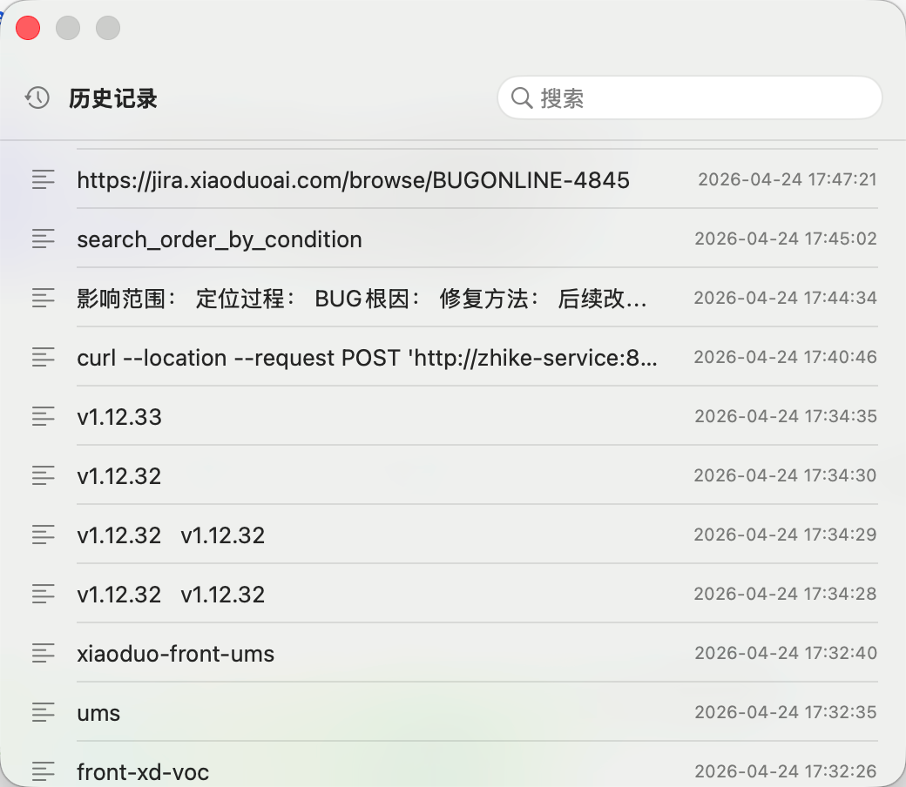
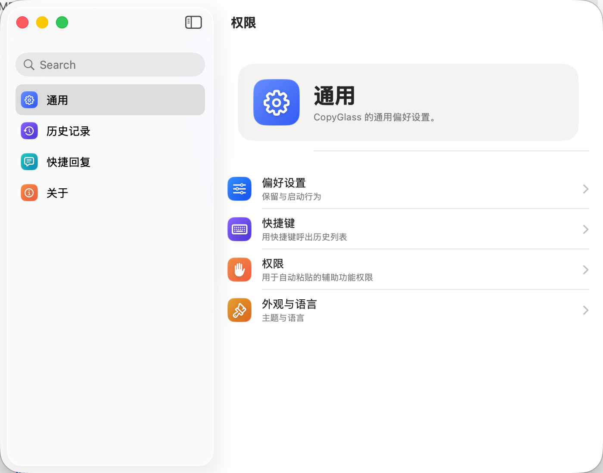

# CopyGlass

CopyGlass 是一款面向 macOS 的剪切板管理工具，采用 Swift、SwiftUI 和 AppKit 构建。它常驻菜单栏，提供剪切板历史、快捷回复、全局快捷键和快速搜索能力，让高频复制、查找和粘贴流程更轻。

[](https://github.com/go-kenka/CopyGlass/actions/workflows/build.yml)

## 特性

- **菜单栏常驻**：应用以 `LSUIElement` 模式运行，不占用 Dock。
- **剪切板历史**：自动记录文本、富文本和图片剪切板内容。
- **快捷回复**：保存常用回复、代码片段、模板文本，并快速复制粘贴。
- **全局快捷键**：无需切换应用，即可呼出主窗口、历史面板和快捷回复面板。
- **快速面板**：使用浮动 `NSPanel` 呈现历史和快捷回复，支持键盘上下选择、回车粘贴、`Cmd+F` 聚焦搜索框。
- **全文搜索**：历史记录使用 SQLite FTS5 建立全文索引，支持更快的内容检索。
- **拼音检索**：中文内容会生成拼音索引，便于使用拼音关键词搜索。
- **保留策略**：支持按 7 天、30 天或永久保留历史记录。
- **截图**：区域截图、窗口截图、全屏截图和滚动（长图）截图，基于 ScreenCaptureKit 采集原生分辨率画面。
- **窗口优先**：进入截图先高亮光标下的窗口，单击即截该窗口，拖动则自由框选。
- **文字提取**：使用系统 Vision 框架（与 image-viewer 参考实现一致）识别截图中的中英文文字，可整段或分块复制。
- **原地标注**：类似飞书的编辑体验，工具栏浮在选区下方，冻结画面上直接绘制矩形、椭圆、箭头、画笔、荧光笔、文字、序号和马赛克，支持撤销 / 重做。
- **固定到屏幕**：把截图钉在屏幕最上层，可拖动、缩放、调整不透明度，并支持复制 / 保存 / 取字。
- **Liquid Glass 风格**：窗口采用半透明、毛玻璃视觉，贴近 macOS 原生体验。

## 预览

历史记录面板


设置面板


## 系统要求

- macOS 14 Sonoma 或更高版本
- Xcode Command Line Tools
- Swift 5.9 或更高版本

## 安装

前往 [Releases](https://github.com/go-kenka/CopyGlass/releases) 下载最新的 `CopyGlass.zip`，解压后将 `CopyGlass.app` 拖入 `Applications` 目录。

> 当前自动构建产物未做代码签名和 notarization。首次运行时，macOS 可能会显示安全提示，需要在「系统设置」中允许打开。

## 截图

菜单栏图标 → **截图**，或使用全局快捷键：

| 功能 | 默认快捷键 |
| --- | --- |
| 区域截图（拖动选择，单击可选中窗口） | `Cmd+Shift+A` |
| 窗口截图 | `Cmd+Shift+W` |
| 全屏截图 | `Cmd+Shift+F` |
| 滚动截图（长图） | `Cmd+Shift+X` |
| 提取文字（截图后直接识别） | `Cmd+Shift+T` |

### 截图方式（窗口优先）

进入截图模式后，屏幕会冻结，**光标所在的窗口会自动高亮**：

- **单击** → 直接截取该窗口
- **拖动** → 自由框选任意区域（此时窗口高亮消失）
- **回车** → 截取当前高亮的窗口
- **Esc / 右键** → 取消

选中后不会另开窗口，而是像飞书一样在**冻结的画面原地标注**，工具栏浮在选区下方（下方空间不够时自动移到上方）。

选区画好后仍然可以调整：拖动选区边框上的 8 个手柄缩放；用**选择 / 移动**工具（默认）拖动选区内部平移。已画的标注会固定在冻结画面的原位置，不会跟着选区移动。

| 工具栏 | 说明 |
| --- | --- |
| 工具 | 矩形、椭圆、箭头、画笔、荧光笔、文字、马赛克、序号 |
| 线条 | 左侧选粗细，右侧选颜色（与飞书一致） |
| 撤销 / 重做 / 清空 | 编辑历史 |
| 提取文字 | 识别选区中的中英文文字，面板内可整段复制或点按某一行复制，并可在图上高亮文字区域；复制后直接关闭截图 |
| 固定到屏幕 | 把截图钉在屏幕最上层（可拖动、缩放、调透明度） |
| 保存 | 保存到本地文件 |
| 复制 | 复制到剪贴板并关闭 |
| 取消 | 放弃本次截图 |

### 修改已画的标注

工具栏第一个是**选择 / 移动**工具（默认选中，快捷键 `V`）：

- **鼠标移到标注上** → 出现浅色提示框，光标变成手形；**单击即可拖动**（矩形、椭圆、箭头、马赛克、画笔、文字、序号都可以整体移动）
- **选中后四周出现 8 个手柄**（箭头是两端两个），拖动手柄即可**缩放 / 改变箭头方向**
- **单击文字标注** → 直接进入输入状态（不用双击）；拖动它才是移动。输入框是**透明底 + 细边框**，文字水平垂直居中，**宽度跟随文字长度自动伸缩**；清空内容并回车会删除该标注
- **Delete / Backspace** 删除选中的标注，**方向键**微调 1px（按住 Shift 为 10px）
- 即使当前是绘制工具，**直接点在已有标注上也会选中并拖动它**；若要在已有标注上方画新图形，按住 **Option** 再拖
- `Esc` 先取消选中，再按一次才退出截图

快捷键：`Esc` 取消、`回车` 复制并关闭、`⌘C` 复制、`⌘S` 保存、`⌘Z` / `⌘⇧Z` 撤销 / 重做，工具键 `V` 选择、`R` 矩形、`E` 椭圆、`A` 箭头、`P` 画笔、`H` 荧光笔、`T` 文字、`M` 马赛克、`N` 序号。

**滚动截图**：框选区域后自动向下滚动并拼接成长图，悬浮面板可随时停止；到达页面底部（画面不再变化）时会自动结束，也可以在检测不到位移时自动反向重试一次。拼接结果会打开编辑器窗口，便于继续标注、取字、复制或保存。

**提取文字（⌘⇧T）**：框选后直接进入标注界面并开始识别，识别结果面板可以整段或按行复制；复制后截图遮罩直接关闭并恢复前台应用。

> 识别性能：Vision 的识别模型在**首次调用**时需要从磁盘加载资源，实测冷启动约 13-14 秒、之后的调用只要 0.1 秒左右（同一台机器实测：全屏 3024×1964 精确模式 0.12s、1512 宽 0.09s、1000 宽 0.08s）。因此应用启动时会在后台预加载模型，进入截图模式时也会再预热一次，把这段等待从"点提取文字时"挪到"启动时"。代价是常驻内存增加约 45MB。
>
> 另外实测：`.fast` 模式虽然快 4 倍，但中文会识别成乱码；把图片缩小到 1000px 虽然略快，中文也会开始出错。所以默认保持"精确 + 语言纠正 + 全分辨率"，不做画质妥协。同一次截图重复点击「提取文字」会直接复用结果，不会重新识别。

## 权限

CopyGlass 需要以下权限：

- **辅助功能**：用于自动粘贴（把剪切板内容直接粘贴到前台应用）。
- **屏幕录制**：用于截图。首次截图时系统会弹窗申请，也可以在「系统设置 → 隐私与安全性 → 屏幕录制」中手动授权。

授权步骤：

1. 打开「系统设置」。
2. 进入「隐私与安全性」。
3. 在「辅助功能」中添加并启用 `CopyGlass.app`。
4. 在「屏幕录制」中启用 `CopyGlass.app`（若列表中没有，先触发一次截图让系统登记）。
5. 重启 CopyGlass。

如果你重新打包或更换了 Bundle ID，macOS 可能会把它视为新的应用，需要重新授权。`bundle_app.sh` 会用固定的标识符做 ad-hoc 签名；但 ad-hoc 签名的 designated requirement 绑定 cdhash，重新构建后仍然可能需要重新授权——如果需要跨构建稳定保留授权，请改用固定的开发者证书签名。

## 默认快捷键

| 功能 | 默认快捷键 |
| --- | --- |
| 打开主窗口 | `Cmd+Shift+V` |
| 打开历史面板 | `Cmd+O` |
| 打开快捷回复面板 | `Cmd+P` |
| 区域截图 | `Cmd+Shift+A` |
| 窗口截图 | `Cmd+Shift+W` |
| 全屏截图 | `Cmd+Shift+F` |
| 滚动截图 | `Cmd+Shift+X` |
| 提取文字 | `Cmd+Shift+T` |
| 搜索当前面板 | `Cmd+F` |
| 面板内选择上一项 / 下一项 | `↑` / `↓` |
| 复制并粘贴选中项 | `Enter` |
| 关闭面板 | `Esc` |

快捷键可以在应用设置中修改。

## 从源码构建

克隆仓库：

```bash
git clone https://github.com/go-kenka/CopyGlass.git
cd CopyGlass
```

运行测试：

```bash
swift test --disable-sandbox
```

构建可执行文件：

```bash
swift build --disable-sandbox
```

打包为 `.app`：

```bash
./bundle_app.sh
```

构建 release 版本：

```bash
CONFIGURATION=release ./bundle_app.sh
```

打包完成后会在项目根目录生成 `CopyGlass.app`。

## 自动发布

仓库包含 GitHub Actions 工作流：[`.github/workflows/build.yml`](.github/workflows/build.yml)。

工作流只在推送 `v*` tag 时自动触发，也可以在 GitHub Actions 页面手动触发：

```bash
git tag v1.0.0
git push origin v1.0.0
```

触发后会执行：

1. 运行测试。
2. 使用 release 配置构建 `CopyGlass.app`。
3. 压缩为 `CopyGlass.zip`。
4. 上传 GitHub Actions artifact。
5. 对 `v*` tag 创建 GitHub Release，并上传 `CopyGlass.zip`。

## 数据存储

CopyGlass 使用 SQLite 保存本地数据，默认目录为：

```text
~/Library/Application Support/CopyGlass
```

历史记录使用 SQLite FTS5 建立全文索引。数据只存储在本机，项目当前没有远程同步逻辑。

## 技术栈

- Swift 5.9
- SwiftUI
- AppKit
- ScreenCaptureKit（截图 / 滚动截图采集）
- Vision（`VNRecognizeTextRequest` 文字识别，中文 + 英文）
- Carbon HotKey API
- SQLite / FTS5
- GitHub Actions

## 项目结构

```text
Sources/
  App/              App 入口、状态栏控制、浮动面板控制
  Models/           剪切板和快捷回复数据模型
  Storage/          SQLite 存储、FTS5 查询、数据表初始化
  Screenshot/       截图采集、区域选择、滚动拼接、标注、文字识别、固定窗口
  Utils/            快捷键、路径、粘贴板、格式化等工具
  ViewModels/       剪切板监听、快捷回复和面板状态
  Views/            设置页、历史列表、快捷回复和通用组件
Tests/              单元测试
Tools/              图标生成工具
```

### 截图模块结构

```text
Sources/Screenshot/
  ScreenCaptureService.swift           ScreenCaptureKit 封装（显示器 / 区域 / 窗口）
  ScreenGeometry.swift                 全局坐标与显示器坐标转换
  WindowHitTester.swift                点击选择窗口时的窗口命中测试
  RegionSelectionController.swift      冻结屏幕的选区与编辑流程编排（窗口优先、原地标注、动作分发）
  SelectionOverlayView.swift           覆盖层视图：十字线 / 放大镜 / 窗口高亮 + 原地标注绘制与鼠标交互
  CaptureSession.swift                 单次截图的可观察编辑状态（图形、撤销重做、OCR、导出）
  ScreenshotToolbarView.swift          选区下方的浮动工具栏与文字识别面板
  ImageStitcher.swift                  基于行特征的重叠匹配与长图拼接算法
  ScrollingCaptureController.swift     自动滚动截图 + 悬浮控制面板
  OCRService.swift                     Vision 文字识别与行分组
  AnnotationModels.swift               标注工具与图形模型
  AnnotationRenderer.swift             标注绘制（覆盖层预览与导出共用同一套绘制代码）
  AnnotationCanvasView.swift           长图编辑器的画布 NSView + SwiftUI 桥接
  ScreenshotEditorModel.swift          长图编辑器状态、撤销 / 重做、导出
  ScreenshotEditorView.swift           长图编辑器界面
  ScreenshotEditorWindowController.swift 长图编辑器窗口与生命周期管理
  PinWindowController.swift            固定到屏幕的浮窗
  ScreenshotController.swift           菜单栏 / 快捷键的统一入口
  ScreenshotSupport.swift              偏好设置、剪贴板与保存
  ImageUtils.swift                     图像裁剪、编码等工具
```

## 开发提示

- 应用通过 `NSPasteboard.changeCount` 轮询剪切板变化。
- 快捷键使用 Carbon 框架注册全局热键。
- 打包脚本会复制 `Info.plist`、图标和 SwiftPM 资源 bundle。
- Bundle ID 当前为 `com.github.go-kenka.CopyGlass`。

## 许可证

当前仓库尚未包含 LICENSE 文件。发布开源版本前，建议补充明确的开源许可证，例如 MIT、Apache-2.0 或 GPL。
